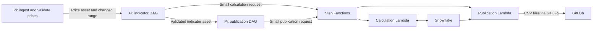

# Bitcoin cloud workers

Airflow on the Raspberry Pi ingests hourly Binance prices and controls execution.
Two container-image Lambda workers in `eu-west-3` perform the expensive work:

- `airflow-bitcoin-calculate`: reads Snowflake, calculates TA-Lib indicators, and
  merges every affected row, including rows after a repaired historical gap.
- `airflow-bitcoin-publish`: reads matching Snowflake snapshots, generates both
  CSVs, and uploads Git LFS objects before pushing the dataset commit to GitHub.



The Standard state machine `airflow-bitcoin-workers` dispatches one action per
execution. Airflow asset dependencies enforce ingestion → calculation →
publication, and each DAG allows one active run. Operators defer while waiting,
freeing the Pi worker slot. Only timestamps, execution ARNs, and result metadata
travel through Airflow; CSV bytes travel between Snowflake, AWS, and GitHub.

Each worker has 3 GB RAM, 2 GB temporary disk, and a 900-second timeout. Credentials
come from project-scoped Secrets Manager secrets populated from the working
Airflow service credentials. The temporary troubleshooting PAT is unused.
The calculation role can read only the Snowflake secret; the publisher can read
both the Snowflake and GitHub secrets. All project IAM identities have the
permissions boundary. The Pi uses the encrypted `aws_bitcoin_workers` connection,
whose IAM user can only start this workflow and inspect its executions.

## Deploy and enable

Create the boundary policy using `infra/aws/worker-permissions-boundary.json`,
then attach `infra/aws/deployer-policy.json` to the dedicated deployment user.
Configure the local AWS profile `airflow-bitcoin-deployer`. The original backup
identity is independent of this deployment.

From the repository root:

```bash
docker compose run --rm --no-deps --entrypoint python \
  --volume "$PWD:/workspace" \
  --volume /home/mouad/.aws:/opt/airflow/aws:ro \
  -e AWS_SHARED_CREDENTIALS_FILE=/opt/airflow/aws/credentials \
  -e AWS_CONFIG_FILE=/opt/airflow/aws/config \
  -e AWS_PROFILE=airflow-bitcoin-deployer \
  airflow-scheduler /workspace/infra/aws/deploy_workers.py

docker compose run --rm --no-deps --entrypoint python \
  --volume "$PWD:/workspace" airflow-scheduler \
  /workspace/infra/aws/configure_airflow.py prepare

docker compose run --rm --no-deps --entrypoint python \
  --volume "$PWD:/workspace" \
  --volume /home/mouad/.aws:/opt/airflow/aws:ro \
  -e AWS_SHARED_CREDENTIALS_FILE=/opt/airflow/aws/credentials \
  -e AWS_CONFIG_FILE=/opt/airflow/aws/config \
  airflow-scheduler /workspace/infra/aws/configure_airflow.py install

docker compose up -d --no-deps \
  airflow-apiserver airflow-scheduler airflow-dag-processor airflow-triggerer
```

The deployer bootstraps scoped IAM roles, Secrets Manager, ECR, and CodeBuild.
CodeBuild builds and tests the image in AWS; the Pi uploads only a small source
archive to the private encrypted build bucket. CloudFormation deploys the two
functions and state machine. `infra/aws/deployment-state.json` records resource
identifiers locally and is ignored by Git. Subsequent deployments reuse the
existing runtime credential and use a content-based image tag.

The installer preserves the existing Fernet key, encrypts the AWS connection,
and adds `BITCOIN_WORKER_STATE_MACHINE_ARN` to `.env`. Deployment CI preserves
these local settings when replacing other environment values. Keep the Fernet
key with metadata database backups.

## Operation and recovery

Worker logs appear in CloudWatch groups `/aws/lambda/airflow-bitcoin-calculate`
and `/aws/lambda/airflow-bitcoin-publish`; build logs appear in
`/aws/codebuild/airflow-bitcoin-workers-image`. Airflow task logs remain local.
No dataset or Airflow log bucket is needed for these workers. CloudWatch logs
retain 14 days. Deferred retries create a new execution for the new attempt;
normal resumes continue waiting for the existing execution.

Daily ingestion pages from its saved watermark through the last closed hour.
For an interior historical repair, trigger `btc_price_dataset` with
`{"repair_from_timestamp": 1794009600}` (an hourly Unix timestamp). The changed
range flows through both assets. Publication refuses unmatched source and
indicator watermarks or missing indicator rows. A Git LFS upload failure
prevents new CSV pointers from being pushed.

Before reverting to local execution, wait for active cloud executions and DAG
runs to finish, clear `BITCOIN_WORKER_STATE_MACHINE_ARN` in `.env`, and recreate
the four Airflow services. Preserve `AIRFLOW_FERNET_KEY` in either mode.

Lambda has a 15-minute execution limit. Large historical initializations may
need bounded batches or an ECS worker. AWS usage incurs Lambda, Step Functions,
CodeBuild, Secrets Manager, ECR, CloudWatch, and small build-bucket charges.
The stack does not deploy automatically on Git pushes; run the deployment
command after changing the worker image or shared calculation code.

## Verified deployment

On November 12, 2026, the asset chain completed through both cloud operators.
Calculation validated data through `2026-11-12 01:00 UTC`; the warm calculation
used about 4.4 seconds of Lambda execution time and 237 MB peak memory.
Publication exported 143,139 price rows and 142,419 indicator rows, uploaded
about 168 MB through Git LFS, and pushed dataset commit
`34ec0c31011851f079a67fdecbfee302fda252f7`. Its state-machine execution took
87 seconds, including cold initialization; Lambda execution took 76 seconds
and peaked at 893 MB. Both Airflow tasks deferred while waiting.

The regression suite passed 31 Airflow tests and five worker tests run as a
non-root user inside the x86 Lambda image before publication.

References: [Lambda timeout](https://docs.aws.amazon.com/lambda/latest/dg/configuration-timeout.html)
and [container-image requirements](https://docs.aws.amazon.com/lambda/latest/dg/images-create.html).
